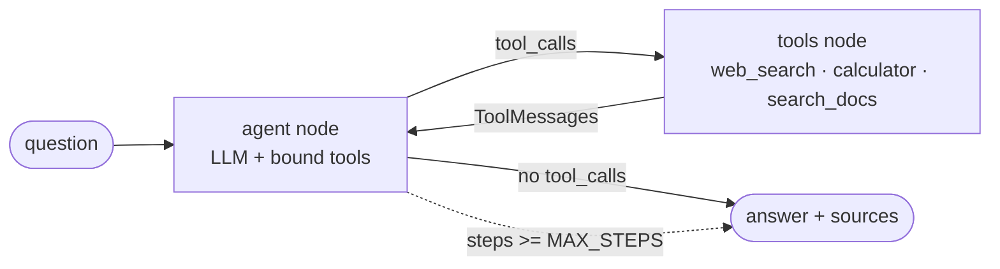
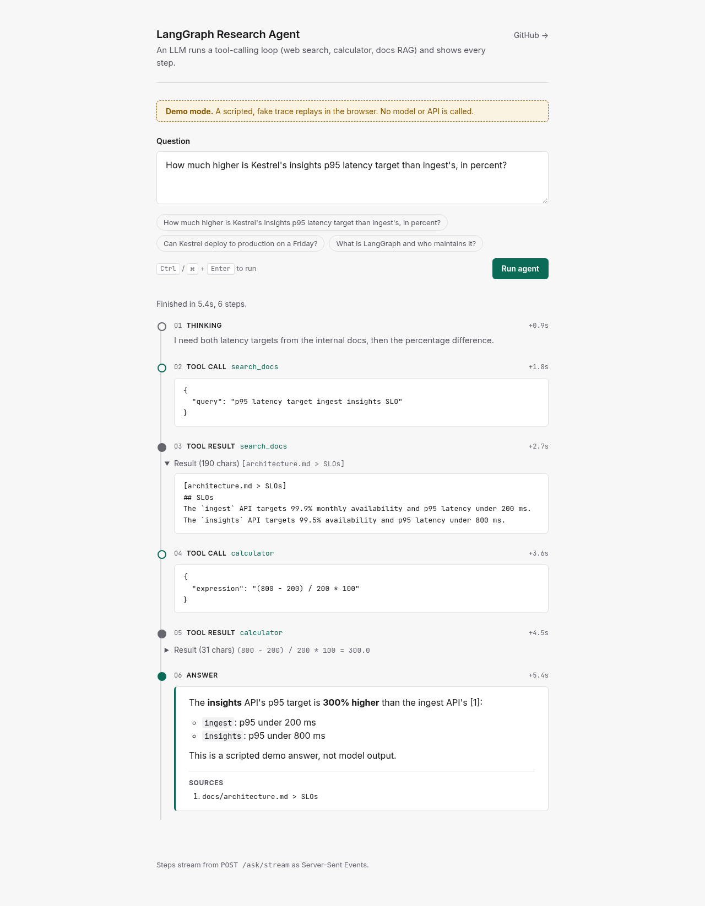

# LangGraph Research Agent

[](https://github.com/Usman5K/langgraph-research-agent/actions/workflows/ci.yml)

[](LICENSE)

**An LLM that drives its own research loop.** It decides which tool to call, reads the result,
decides again, and stops when it can answer with cited sources. The loop is an explicit
[LangGraph](https://github.com/langchain-ai/langgraph) state machine that you can read,
test and stream step by step.

- **3 real tools:** web search (Tavily or DuckDuckGo), a sandboxed calculator (AST, no `eval`) and
  RAG over a markdown knowledge base
- **A guarded loop:** a step counter in the graph state stops runaway tool calling
- **Observable:** every thought, tool call, tool result and answer streams over SSE to a CLI, a
  JSON API and a no-build web UI
- **Tested offline:** a scripted fake LLM drives the real graph, so `pytest` needs no API key
- **Production basics:** typed config with `pydantic-settings`, FastAPI, Docker, `uv` lockfile,
  ruff and GitHub Actions CI

## How the loop works



This is the **ReAct / tool-calling pattern**. The model reasons about the question and *acts* by
emitting structured tool calls. It then observes the results, which are appended to the
conversation as `ToolMessage`s, and repeats. The LLM is the control flow: no hard-coded "search,
then calculate" pipeline.

### Why LangGraph instead of a `while` loop?

| Concern | How it is handled here |
| --- | --- |
| **Explicit state** | `AgentState` is a typed dict: `messages` (merged with the `add_messages` reducer) plus `steps`. Every node returns a *delta*, so the state is easy to inspect, test and persist. |
| **Conditional edges** | `route_after_agent` is a plain function: tool calls go to `tools`, anything else goes to `END`. It is unit tested on its own. |
| **Step guard** | The `agent` node counts its own turns and ends the run once `MAX_STEPS` is reached, so a confused model can't loop forever or burn tokens. |
| **Streaming** | `graph.astream(stream_mode="updates")` yields one update per node, which become the step trace for the CLI, API and UI. |
| **Room to grow** | Checkpointers (memory), interrupts (human approval) and sub-graphs plug into the same graph. |

The core is about 60 lines in [`src/agent/graph.py`](src/agent/graph.py).

## Quickstart

Requires Python 3.11+ and [uv](https://docs.astral.sh/uv/). Plain `pip install -e .` also works.

```bash
git clone https://github.com/Usman5K/langgraph-research-agent.git
cd langgraph-research-agent
uv sync                      # creates .venv from the lockfile
cp .env.example .env         # then set OPENAI_API_KEY (TAVILY_API_KEY is optional)
uv run pytest                # runs offline, no key needed
```

## Two ways to run it

**1. CLI.** Prints each step as a coloured panel:

```bash
uv run python -m agent "How much higher is Kestrel's insights p95 latency target than ingest's, in percent?"
```

**2. Web UI + API:**

```bash
uv run uvicorn agent.api:app --reload --port 8000
```

Then open **http://localhost:8000**. The UI is a single static HTML file: vanilla JS, system
fonts, no framework, no build step and no CDN. It reads the SSE stream and draws the run as a
timeline: numbered steps with elapsed time, tool args in monospace, collapsible tool results, and a
final answer with safely rendered markdown and a source list. It has light and dark themes,
<kbd>Ctrl</kbd>/<kbd>⌘</kbd>+<kbd>Enter</kbd> to run, a Stop button, and separate states for a
missing API key, a dropped connection and the step limit.



*The screenshot is the built-in **UI preview**: open http://localhost:8000/?demo=1 to replay a
scripted, clearly fake trace in the browser. No API key is needed and no model is called, so it is
not real agent output.*

| Endpoint | Description |
| --- | --- |
| `GET /` | Web UI |
| `POST /ask` | `{"question": "..."}` returns `{"answer": "...", "steps": [...]}` |
| `POST /ask/stream` | Same input, streamed as Server-Sent Events (`tool_call`, `tool_result`, `answer`, `done`, `error`) |
| `GET /health` | Liveness check |

```bash
curl -N -X POST localhost:8000/ask/stream -H 'content-type: application/json' \
  -d '{"question": "What is 17% of the 200 ms ingest latency SLO?"}'
```

Docker: `make docker` (builds the image and runs it on port 8000 with your `.env`).

## Example trace (illustrative)

> **Illustrative only.** This trace shows the *shape* of a run. It was written by hand, not
> captured from a live model call, so the exact wording, tool choices and step count of a real
> run will differ.

```text
question: How much higher is Kestrel's insights p95 latency target than ingest's, in percent?

[tool call] search_docs {"query": "p95 latency target ingest insights SLO"}
[result]    [architecture.md > SLOs] The `ingest` API targets 99.9% monthly availability and
            p95 latency under 200 ms. The `insights` API targets ... p95 latency under 800 ms.
[tool call] calculator {"expression": "(800 - 200) / 200 * 100"}
[result]    (800 - 200) / 200 * 100 = 300.0
[answer]    The insights API's p95 target (800 ms) is 300% higher than ingest's (200 ms) [1].
            Sources: [1] docs/architecture.md > SLOs
```

## Tools

| Tool | What it does |
| --- | --- |
| `web_search` | Tavily when `TAVILY_API_KEY` is set, otherwise DuckDuckGo via `ddgs`. Returns numbered results with URLs to cite. Provider errors are returned to the LLM as text instead of crashing the run. |
| `calculator` | Walks the Python AST and only allows numbers, `+ - * / // % **`, parentheses and `abs/round/sqrt/min/max`. Names, attributes, strings, keyword arguments and huge exponents are rejected. |
| `search_docs` | RAG over `./docs`: markdown is split per `##` section and embedded into an `InMemoryVectorStore`. It uses OpenAI `text-embedding-3-small` when a key is present, otherwise an offline hashing embedder (used in tests). The sample docs are a made-up handbook for "Kestrel Analytics". |

## Configuration

Set these as environment variables or in `.env`. They are loaded by
[`config.py`](src/agent/config.py) using `pydantic-settings`.

| Variable | Default | Purpose |
| --- | --- | --- |
| `OPENAI_API_KEY` | none | Needed for live runs |
| `MODEL` | `gpt-4o-mini` | Chat model for the agent node |
| `TAVILY_API_KEY` | none | Use Tavily instead of DuckDuckGo |
| `MAX_STEPS` | `6` | Max LLM turns per question |
| `DOCS_DIR` | `docs` | Folder indexed by `search_docs` |
| `EMBEDDINGS` | `auto` | `auto`, `openai` or `hashing` |

## Testing

```bash
make test   # pytest
make lint   # ruff check + ruff format --check
```

`tests/conftest.py` defines `ScriptedChatModel`, a `BaseChatModel` that returns pre-written
`AIMessage`s (with or without tool calls). The tests run the **real compiled graph** with it to
check that:

- a tool call routes to `tools` and the result is fed back to the LLM
- a plain answer routes straight to `END`
- the max-steps guard stops a model that never stops calling tools
- the calculator rejects code injection (`__import__`, attribute access, names and more)
- `/ask`, `/ask/stream` (SSE) and `GET /` behave, and a missing API key returns a clean 503
- offline RAG retrieves the right handbook section

## Project structure

```text
.
├── src/agent/
│   ├── graph.py          # AgentState, agent/tools nodes, conditional edge, step guard
│   ├── trace.py          # LangGraph stream updates -> JSON step trace
│   ├── api.py            # FastAPI: GET /, POST /ask, POST /ask/stream (SSE)
│   ├── cli.py            # `python -m agent "question"` with rich output
│   ├── config.py         # pydantic-settings
│   ├── static/index.html # no-build web UI (timeline, dark mode, ?demo=1 preview)
│   └── tools/            # web_search, calculator, search_docs (RAG)
├── docs/                 # sample knowledge base for search_docs (*.md only)
│   └── assets/ui.png     # README screenshot (not indexed)
├── tests/                # offline tests with a scripted LLM
├── Dockerfile · Makefile · pyproject.toml · uv.lock
└── .github/workflows/ci.yml
```

## Extension ideas

- **PGVector:** swap `InMemoryVectorStore` for `langchain-postgres` `PGVector` so the knowledge base
  persists and scales. Only `get_store()` changes.
- **Human-in-the-loop:** compile with a checkpointer and `interrupt_before=["tools"]` so a person
  approves tool calls such as web access or writes before they run.
- **Memory:** add a `MemorySaver` or Postgres checkpointer keyed by `thread_id` for multi-turn
  conversations.
- **Parallel tools and planning:** a planner node that splits a question into sub-questions and
  fans out with `Send`.
- **Evaluation and tracing:** LangSmith or OpenTelemetry traces, plus a small eval set that scores
  answer accuracy and citation coverage.

## Author

**Usman Khan**, Senior Python Backend / AI Engineer (FastAPI, PostgreSQL/PGVector, RAG, LlamaIndex,
AWS). GitHub: [@Usman5K](https://github.com/Usman5K)

Licensed under [MIT](LICENSE).
